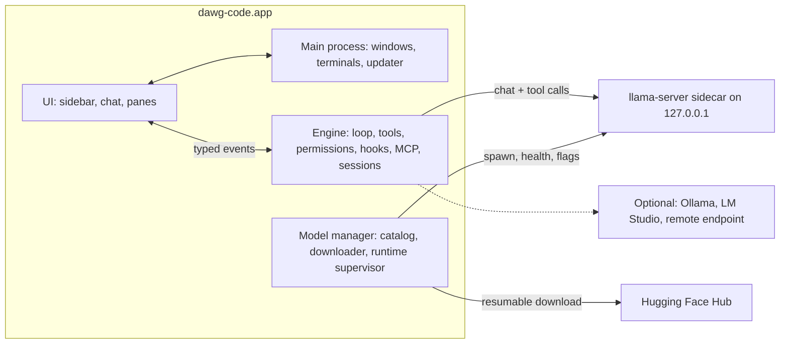

# dawg-code — build plan

_Drafted 2026-11-20. Status: proposal. Nothing is built yet._

## 1. The short version

**What it is.** A Mac desktop coding agent that works the way Claude Code does (same kinds of tools, permission modes, hooks, skills, subagents, MCP, slash commands, plan mode, resumable sessions), where the model is one you download with a single click and run on your own machine.

**The bar.** Claude Code is the standard for features and behaviour. Nothing is scoped down for today's hardware or for small models.

**How we build it.**

1. Own the three parts that make this product different:
   - the **model layer**: a bundled inference runtime, a model catalog and one-click downloads;
   - an **engine designed for local models** from the first line, not a hosted-model harness with a local option bolted on;
   - **native compatibility with Claude Code's config files** (`CLAUDE.md`, `.claude/skills`, `.claude/agents`, `.claude/commands`, hooks, `.mcp.json`), so an existing setup works without conversion.
2. Borrow everything else from permissively licensed projects: llama.cpp for inference, the official MCP SDK, ripgrep, an open-source macOS sandbox, xterm.js, Monaco.
3. Use Electron and TypeScript, one language from the UI to the agent loop.
4. Let an eval suite decide the prompts, the tool designs and which models enter the catalog.

**Three things to know first.**

- **You can already point the real Claude Code at a local model.** Ollama, LM Studio and llama.cpp have all exposed an Anthropic-compatible endpoint since January 2026, and `ollama launch claude` wires it up. It works, with real drawbacks (section 2). It is the fastest way to feel the problem this project solves, and it is our baseline to beat.
- **The design target is a high-memory Apple Silicon Mac running the strongest open models.** A hardware upgrade is planned. Until it arrives, development runs against a hosted endpoint serving the same models (section 10). The current machines do not shape the design.
- **Parts of this already exist.** Goose and LM Studio Bionic both ship an agent with in-app model download. Neither is an open, Mac-first, Claude Code-compatible coding app. That is the gap.

## 2. What exists today

| Option                                                   | What you get                                          | Why it is not the answer                                                                                                                                                                                                                                                        |
| -------------------------------------------------------- | ----------------------------------------------------- | ------------------------------------------------------------------------------------------------------------------------------------------------------------------------------------------------------------------------------------------------------------------------------- |
| Real Claude Code + local endpoint (`ANTHROPIC_BASE_URL`) | The exact Claude Code engine and every feature        | Anthropic's docs say routing to non-Claude models is unsupported. The prompt is about 17–20K tokens, so the first turn takes 60–90 s on a local model. It assumes a 200K window while the server silently truncates. No model management. Cannot be redistributed or rebranded. |
| Goose desktop (Apache-2.0)                               | In-app Hugging Face download and in-process llama.cpp | A general agent, not a Claude Code-style coding app. Small default contexts. Hooks are minimal. Mid-rewrite.                                                                                                                                                                    |
| LM Studio Bionic (closed source)                         | In-app download, diffs, checkpoints, sandbox          | Closed. Reviews report failed file writes and shell calls on a 24 GB Mac.                                                                                                                                                                                                       |
| OpenCode desktop (MIT)                                   | The closest open feature set; Electron app            | No built-in inference. Its own config formats; reads `CLAUDE.md` and `.claude/skills` but not hooks, agents, commands or `.mcp.json`.                                                                                                                                           |
| Osaurus (MIT)                                            | Native Swift + MLX agent                              | Not coding-focused.                                                                                                                                                                                                                                                             |

Community reports on local coding agents repeat the same complaints: malformed tool-call JSON, edits that fail on whitespace, loops, and the whole context being re-processed every turn. Section 7 is the design answer to each.

## 3. Product definition

**Goals**

- Install the app, click once, and be coding with a local model. No terminal, no separate Ollama or LM Studio install.
- Parity with Claude Code for everything that does not need Anthropic's cloud (section 8).
- An existing Claude Code setup loads as-is: instructions, skills, agents, commands, hooks, MCP servers.
- Fully offline after the model download. No account, no telemetry by default.

**Non-goals**

- Cloud sessions, remote control from phone or web, hosted code review, artifact publishing, account-synced skills and connectors. These depend on Anthropic's services.
- Windows and Linux (the engine stays portable, the app does not target them yet).
- Hosted closed models as a headline feature. Any OpenAI-compatible endpoint can be attached, but local is the default path.
- Copying Claude Code's visual design. We match the layout conventions and workflow; the look, icons and wording are our own (section 12).

**Target hardware.** Apple Silicon with 24 GB or more of unified memory, macOS 14 or later. The design target is 64 GB and up, running the strongest open models available. Intel Macs can launch the app and attach to a remote endpoint, but are not an inference target.

**Small machines do not shape the design.** No feature, tool or prompt is cut, simplified or gated to suit small models. A user can still load a small model by hand on a 16 GB Mac, and getting that to work is useful practice, but it is best-effort and never a reason to hold a capability back.

**What to expect by memory.** Every feature works with a local model. How well depends on the model, and the model depends on memory:

| Unified memory | Experience                                                                |
| -------------- | ------------------------------------------------------------------------- |
| 24–32 GB       | Real multi-file work with a 20–30B model at 48–64K context.               |
| 48–64 GB       | A 27B-class model at high precision with 128K–200K context.               |
| 128 GB         | Full precision, the largest open models that fit, and parallel subagents. |

## 4. Key decisions

| Decision             | Choice                                                                            | Why                                                                                                                                                                                                                                                   |
| -------------------- | --------------------------------------------------------------------------------- | ----------------------------------------------------------------------------------------------------------------------------------------------------------------------------------------------------------------------------------------------------- |
| Agent engine         | Our own, in TypeScript, clean-room                                                | Claude-config compatibility and local-model reliability both live inside the loop. They are the product, so we need to own them. Details below.                                                                                                       |
| App shell            | Electron + React + Vite                                                           | One language with the engine, which runs on the Node that Electron already ships. Terminal (node-pty, xterm.js) and diff (Monaco) are well-trodden. OpenCode moved its desktop app from Tauri to Electron in May 2026 over WebKit rendering problems. |
| Bundled runtime      | `llama-server` from llama.cpp (MIT)                                               | A single native binary with official macOS arm64 and x64 builds. OpenAI and Anthropic APIs. Grammar-constrained tool calls. The most complete prompt-cache controls.                                                                                  |
| Faster runtime later | MLX as an optional "engine pack"                                                  | Roughly 20–40% faster generation on Apple Silicon, but every maintained server needs a bundled Python environment. Not worth it in the base app.                                                                                                      |
| Other runtimes       | Attach, never bundle                                                              | Detect a running Ollama or LM Studio and offer it. LM Studio's terms forbid redistribution.                                                                                                                                                           |
| Engine ⇄ UI protocol | Our own typed event protocol, schemas as the source of truth                      | Lets the UI, a headless CLI and tests share one contract. An Agent Client Protocol (ACP) adapter comes later, so the engine also works in other editors.                                                                                              |
| Config               | Read `.claude/` and `~/.claude/` read-only; write only to `.dawg/` and `~/.dawg/` | Existing setups just work, and we never corrupt a real Claude Code install.                                                                                                                                                                           |
| Licence              | Apache-2.0                                                                        | Patent grant, and a `NOTICE` file is the natural place to credit code ported from MIT and Apache projects.                                                                                                                                            |

### The engine choice in more detail

| Path                                                    | Time to first usable            | Parity ceiling                                                                                                                      | Main risk                                                                                                    |
| ------------------------------------------------------- | ------------------------------- | ----------------------------------------------------------------------------------------------------------------------------------- | ------------------------------------------------------------------------------------------------------------ |
| **A. Own engine (recommended)**                         | About 3 weeks for the core loop | No ceiling: the public Claude Code docs are the spec                                                                                | More code to harden ourselves                                                                                |
| B. Embed OpenCode as a sidecar                          | About 1 week                    | Hooks, settings rules, agent files and plugins need a translation layer over a different model; some cannot be done without forking | Fast-moving upstream (2.0 just landed, its server API is marked experimental)                                |
| C. A GUI that drives the user's own Claude Code install | Days                            | Exact                                                                                                                               | Explicitly unsupported by Anthropic for non-Claude models, can break at any release, cannot ship or brand it |

Why A:

- **Parity has no ceiling.** Every Claude Code behaviour is ours to implement directly, instead of being approximated on top of another harness's concepts.
- **The engine needs one provider, not seventy.** It only ever talks to a local OpenAI-compatible endpoint, which removes most of what makes general harnesses large.
- **Speed depends on how the prompt is handled.** A local model re-processes whatever part of the prompt changed. Harnesses built for hosted models change it constantly. Keeping the cache valid across turns dictates how history, compaction and subagents are built (section 7), so it has to be designed in.
- **We still don't write everything.** Hardened pieces such as tolerant edit matching can be ported from MIT and Apache projects with attribution.

**Fallback trigger.** Phase 0 runs the same task suite through existing harnesses. If our core loop cannot match the best of them on that suite by the end of Phase 2, we switch to path B behind the same UI protocol. Path C stays useful as a personal stopgap and as the behaviour reference in evals.

## 5. Architecture



The engine runs in its own process so a crash or a long tool call never freezes the window, and so the same engine powers a headless `dawg -p` command.

```
dawg-code/
  apps/desktop/        Electron main, preload, React renderer
  packages/protocol/   Event and request schemas (source of truth for types)
  packages/engine/     Agent loop, tools, permissions, compaction, sessions
  packages/compat/     Readers for Claude Code conventions: settings, hooks,
                       skills, agents, commands, .mcp.json, plugins
  packages/models/     Hardware probe, catalog, downloader, llama-server supervisor
  packages/cli/        Headless entry point
  evals/               Task suite, runner, scoreboard
  catalog/             Model catalog and per-model profiles (data, not code)
```

## 6. The model layer: "one click"

**First-run flow**

1. Probe the machine: chip, performance cores, unified memory, free disk.
2. Show one recommended model with its download size and licence. One button: _Download and start_. Other fitting models sit behind "More options".
3. Download with resume and checksum verification. Show speed and time left.
4. Start `llama-server` with flags chosen for this machine, wait for its health check, then pre-load the static prompt prefix so the first message answers quickly.
5. The chat box is live. Later launches skip straight to step 4.

**Catalog.** A data file in this repo, fetched at launch with the bundled copy as fallback, so new models ship without an app release. Each entry holds: Hugging Face repo and file, SHA-256, size, licence, minimum memory, chip class, default context, sampler and reasoning settings, and the id of its profile. No model enters the default catalog without passing the eval suite.

**Download.** Hugging Face's file listing gives size and SHA-256 per file, used for the disk check and verification. Transfers use plain HTTP range requests for resume. Files go in the standard Hugging Face cache (`~/.cache/huggingface/hub`), and the app discovers models already downloaded by LM Studio or Ollama instead of downloading them again.

**Choosing a quantization.** Budget about 70% of unified memory. Require weights + cache at the target context + 2 GB to fit. Prefer the highest precision that fits, and never default below 4-bit: tool calling degrades first.

**Runtime supervision.** One `llama-server` child process bound to 127.0.0.1 on a random port with a per-launch key. The supervisor sets context length explicitly, reserves cache slots for subagents, restarts on crash, swaps models, and unloads after an idle period. The llama.cpp build is pinned and bumped deliberately.

**Starting catalog** (existence, sizes and licences were checked against the Hugging Face API on 2026-11-20; re-verify when the catalog is built, since this moves monthly):

| Memory | Default model                               | Download | Context to set | Note                                                                                                                        |
| ------ | ------------------------------------------- | -------- | -------------- | --------------------------------------------------------------------------------------------------------------------------- |
| 24 GB  | gpt-oss-20b, 4-bit                          | 11.6 GB  | 48–64K         | Text only                                                                                                                   |
| 32 GB  | Qwen3.8-27B, 4-bit                          | 16.6 GB  | 64K            | On base and Pro chips prefer the sparse Qwen3.6-35B-A3B (18 GB): much faster prompt processing. Laguna XS 2.1 (20 GB) needs 36 GB |
| 48 GB  | Qwen3.8-27B, 6-bit                          | 22 GB    | 128K           |                                                                                                                             |
| 64 GB  | Qwen3.8-27B, 8-bit                          | 29 GB    | 200K+          |                                                                                                                             |
| 128 GB | Qwen3.8-27B, 8-bit, with 3–4 subagent slots | 29 GB    | 262K           | Larger sparse models (Laguna S 2.1, gpt-oss-120b, about 65–70 GB) become the default only if they beat the 27B on our suite |

Nothing below 24 GB is in the catalog. Any GGUF file can still be loaded by hand.

The catalog itself now lives in `catalog/catalog.json`, with each file's commit, size and SHA-256 confirmed against Hugging Face. That file, not this table, is the source of truth.

Choose by chip as well as memory. A dense 27B model processes a prompt at only about 200–250 tokens per second on an M4 Max, while sparse models with about 3B active parameters reach 750–1,700. Those speeds are from vendor and community posts, not our own measurements.

## 7. Making local models actually work

This is the hard part of the project and where most of the engineering judgment goes. Each rule answers a failure reported in the wild. None of them removes a capability.

| Failure                                             | Design rule                                                                                                                                                                                                                                                                                              |
| --------------------------------------------------- | -------------------------------------------------------------------------------------------------------------------------------------------------------------------------------------------------------------------------------------------------------------------------------------------------------- |
| Slow first turn                                     | The full prompt and tool set are the default; speed comes from caching, not cutting. The static prefix is processed once, kept on disk and pre-loaded at launch, so each turn only processes new text. MCP and rarely used tool schemas load on demand through tool search, the way Claude Code does it. |
| Whole context re-processed every turn               | The prefix is byte-stable: no timestamps, git status or other changing text near the top. History is append-only. Each agent is pinned to its own cache slot. The model stays loaded.                                                                                                                    |
| Newer hybrid models cannot rewind their cache       | Compact only at cache checkpoint boundaries, keep the model's reasoning blocks in history as its model card requires, and tune the server's checkpoint settings per model.                                                                                                                               |
| Malformed tool-call JSON, or calls written as prose | Constrain tool calls with the server's grammar support. Validate against the schema, return an error the model can act on, retry once. Recover calls emitted as plain text. Lint tool schemas at load for patterns known to break grammar generation.                                                    |
| Edits fail on whitespace                            | The edit tool tries exact match, then whitespace- and indent-tolerant matching, and reports the nearest match on failure.                                                                                                                                                                                |
| Silent context truncation                           | Context is always set explicitly from memory, the real window is shown in the UI, and compaction starts at 60–70%.                                                                                                                                                                                       |
| Loops and early stops                               | Repeat detection, a turn limit, a "keep going until the check passes" nudge, and a reasoning budget per model.                                                                                                                                                                                           |
| Weak planning                                       | Plan mode and the task list are first-class and on by default for multi-step requests.                                                                                                                                                                                                                   |
| Many subagents, one GPU                             | Each subagent gets its own cache slot and they run in parallel when memory allows. Otherwise they queue.                                                                                                                                                                                                 |

**Per-model profiles.** Each catalog entry points to a profile: sampler settings, reasoning settings, chat-template and tool-call quirks. Every catalog model gets the same full prompt and tool set. Prompts and tool descriptions are written from scratch for this project.

**Evals.** A suite of 10–12 real tasks: fix a failing test, add a feature across two files, a rename refactor, write and run a script, answer a question about a repo, an edit with awkward whitespace, a multi-step task with a task list, an MCP tool call, a skill, an exploring subagent, recovery from a failing command, and a long-context task. For each run we record success, turns, wall time, prefix tokens, tool-call error rate, edit failure rate and cache reuse. Every prompt or tool change is judged against it, so each instruction in the default prompt has to earn its place by results.

## 8. Feature parity map

Priority levels: **P0** the app is unusable without it; **P1** a regular Claude Code user expects it; **P2** advanced or long tail. The levels set build order only. Everything in the table gets built.

| Area             | P0                                                                                                                               | P1                                                                                                                                                          | P2                                                                                    |
| ---------------- | -------------------------------------------------------------------------------------------------------------------------------- | ----------------------------------------------------------------------------------------------------------------------------------------------------------- | ------------------------------------------------------------------------------------- |
| Tools            | Read, Write, Edit, Bash (with timeouts and background runs), Glob, Grep                                                          | Task list, ask-the-user questions, web fetch, web search, image input                                                                                       | Notebook edit, LSP diagnostics, monitor, worktree tools                               |
| Loop and context | Streaming loop, `CLAUDE.md` / `AGENTS.md` hierarchy with `@` imports, automatic and manual compaction, context meter             | Auto memory, effort levels mapped to reasoning budgets, a small utility model for titles and summaries                                                      | Output styles, status line                                                            |
| Safety           | Permission modes (manual, accept edits, plan, don't ask, bypass), `Tool(specifier)` allow/ask/deny rules, layered settings files | macOS sandbox for shell commands, checkpoints and rewind                                                                                                    | Auto mode with a local classifier                                                     |
| Extensibility    | Built-in slash commands                                                                                                          | Hooks, skills, custom commands, subagents (Explore, Plan, general-purpose, forks, background), MCP with deferred tool schemas, OAuth, resources and prompts | Plugins and marketplaces, keybindings                                                 |
| Sessions         | Transcripts on disk, resume, fork, rename, headless `-p` with JSON and streaming output                                          | Background tasks, git worktree per session                                                                                                                  | Scheduled and looping tasks, multi-agent workflow scripts, ACP adapter, a library API |
| Desktop          | Session sidebar, chat with tool cards, permission prompts, mode and model pickers                                                | Diff pane with inline comments sent back to the agent, terminal pane, file pane, plan and tasks panes, notifications                                        | Browser preview pane, split view, PR and CI status through `gh`                       |

**Compatibility details**

- Tool names and input field names follow Claude Code's public documentation (`Bash`, `Edit`, `tool_input.file_path`, and so on), because existing hook matchers and permission rules refer to them.
- Hooks receive the documented JSON on stdin and the documented exit-code meanings. Both `CLAUDE_*` and `DAWG_*` environment variables are set. Claude Code documents more than 30 hook events; we implement them in order of real-world use, starting with pre- and post-tool-use, prompt submit, stop, and session start and end.
- Hooks found in an existing Claude Code config run arbitrary commands, so the app lists them and asks once before enabling them.
- Web search has no Anthropic backend here. It is pluggable: an MCP search server or a user-supplied search API key.

**Cannot be replicated locally:** cloud sessions and environments, remote control and mobile, hosted code review, artifact publishing, account-synced skills and connectors, server-managed settings.

## 9. Roadmap

Each phase has a technical spec in [docs/specs](docs/specs/README.md). Durations are rough estimates for one person working with a coding agent, in focused weeks.

| Phase                                     | Scope                                                                                                                                                                                                        | Done when                                                                                                                                         |
| ----------------------------------------- | ------------------------------------------------------------------------------------------------------------------------------------------------------------------------------------------------------------ | ------------------------------------------------------------------------------------------------------------------------------------------------- |
| **0. Foundations** (1 wk)                 | Repo scaffold, licence, CI on macOS arm64 and x64. Eval runner and task suite. Baseline runs of existing harnesses (OpenCode, Pi, and the real Claude Code through a translating proxy) on the target model. | A scoreboard exists with baseline pass rates, and the dev inference setup from section 10 works.                                                  |
| **1. Model layer** (2 wks)                | Hardware probe, catalog, downloader, llama-server supervisor, attach to Ollama / LM Studio / remote. Minimal app: onboarding, download, plain streaming chat.                                                | On a clean Apple Silicon Mac: install, one click, chatting with the catalog model for that machine. No terminal. Sign-off needs the upgraded Mac. |
| **2. Engine core** (3 wks)                | Loop, tool-call parsing and repair, the six core tools plus the task list and ask-the-user tools, permissions, instruction files, sessions, compaction, plan mode, core slash commands, headless mode.       | Pass rate on the suite at least equals the best baseline harness on the same model. Otherwise take path B.                                        |
| **3. Desktop app** (3 wks, overlapping 2) | Everything in the Desktop row at P0 and P1. Worktree per session.                                                                                                                                            | A full day of real work without leaving the app.                                                                                                  |
| **4. Compatibility** (4 wks)              | Hooks, skills, commands, subagents, MCP, checkpoints, sandbox, web tools, memory.                                                                                                                            | Pointing the app at an existing `~/.claude` and a project's `.claude/` loads and runs all of it; a compat test suite passes.                      |
| **5. Long tail and release** (ongoing)    | P2 features, MLX engine pack, ACP adapter. Signing, notarization, auto-update, Homebrew cask.                                                                                                                | A signed, notarized download that updates itself.                                                                                                 |

First daily-drivable build is the end of Phase 3, roughly 8–10 focused weeks. Release needs an Apple Developer Program membership (99 USD a year) for Developer ID signing and notarization. The app ships outside the Mac App Store, because it must spawn processes and read arbitrary project folders.

## 10. Development hardware

The reference machine is a high-memory Apple Silicon Mac that is planned but not here yet. Its specs are not fixed; this plan assumes 64 GB or more.

| Machine                                                                                 | Role                                                                                                                                                                             |
| --------------------------------------------------------------------------------------- | -------------------------------------------------------------------------------------------------------------------------------------------------------------------------------- |
| Upgraded Mac (planned)                                                                  | The reference: catalog models, speed measurements, release testing                                                                                                               |
| Laptop: 2019 Intel MacBook Pro, 16 GB (MacBookPro15,4, macOS 15.7, Node 24, Xcode 26.2) | Writing code, running the app in dev mode, unit tests, building arm64 packages. Cannot run models at useful speed.                                                               |
| Mac mini: M4, 16 GB                                                                     | Optional practice box. Exercises the Apple Silicon build and the download-and-start mechanics with a small model. Not a quality or speed reference, and nothing is tuned for it. |

**Until the upgraded Mac arrives**

1. **Hosted endpoint for the target models.** The engine only needs an OpenAI-compatible URL. Any host serving the same open weights (Qwen3.8-27B and larger) lets us build and evaluate the loop, prompts and tools against the models we are designing for. It is usually pay-per-token, and it cannot show local speed or cache behaviour.
2. **CI on Apple Silicon runners.** GitHub's standard macOS arm64 runners are free for public repositories: build, launch the bundled runtime, and run a smoke test with a tiny model on every push.
3. **Mac mini for mechanics, if wanted.** A developer setting skips the memory check so a small model can be loaded there. This tests the packaged app, runtime supervision and the download flow. A small model failing a hard task there is expected and is not fixed by simplifying the app.

**When it arrives**

- Measure prompt-processing speed, generation speed, cache reuse and first-turn latency for the catalog models. These replace the vendor figures in section 6.
- Re-run the eval suite locally and sign off Phase 1.

## 11. Risks

| Risk                                                                                      | Mitigation                                                                                                                                           |
| ----------------------------------------------------------------------------------------- | ---------------------------------------------------------------------------------------------------------------------------------------------------- |
| Open models trail hosted frontier models, and users blame the app                         | Eval-gated catalog, clear per-tier messaging in onboarding, remote endpoint as an escape hatch                                                       |
| "All the features" is a very long list                                                    | Strict P0/P1/P2 build order, the public docs as the spec, a compat test suite that grows feature by feature                                          |
| The reference Mac is not here yet                                                         | Build against a hosted endpoint serving the same models; local speed tuning and Phase 1 sign-off wait for it                                         |
| Fast-moving ground: llama.cpp ships builds almost daily, strong new models arrive monthly | Pinned runtime build, catalog and profiles as updatable data                                                                                         |
| Someone ships this first                                                                  | Goose and LM Studio already have pieces. Our position is open source, Mac-first, Claude-config-compatible and tuned for local models by measurement. |
| Legal or branding trouble                                                                 | Section 12                                                                                                                                           |

## 12. Legal and branding guardrails

Not legal advice; these are the practical rules the project follows.

- **Clean-room.** Claude Code is proprietary. Its source leaked through an npm source map on 2026-03-31 and Anthropic issued takedowns. Never read that code or anything derived from it, including projects that describe themselves as rewrites of it. Our spec is the public documentation and our own testing.
- **Our own prompts.** System prompts and tool descriptions are written from scratch.
- **Naming.** No "Claude", "Anthropic" or lookalike names and logos in the product, repo name or icon. Anthropic has pushed projects to rename before. Say "compatible with Claude Code configuration files" and add a not-affiliated line to the README. The current GitHub repo description leans on the name and is worth rewording.
- **Look and feel.** Match the workflow and layout conventions; use our own visual design and wording.
- **Dependencies.** Permissive licences only: MIT, Apache-2.0, ISC, 0BSD, BSD-2-Clause and BSD-3-Clause (the BSD licences added by the project owner on 2026-11-27), with notices kept. A package offered under a choice of licences is used under the permissive one (dompurify, which Monaco brings, under Apache-2.0; node-forge, which the sandbox runtime brings, under BSD-3-Clause). Do not copy from AGPL, GPL or source-available projects (opcode, CloudCLI, Zed, Crush).
- **Models.** Show each model's licence before download; most defaults are Apache-2.0, a few are not.

## 13. Open decisions

| #   | Question                                        | Default if unanswered                    |
| --- | ----------------------------------------------- | ---------------------------------------- |
| 1   | How much memory will the upgraded Mac have?     | Assume 64 GB or more                     |
| 2   | Own engine (path A) or embed OpenCode (path B)? | Path A with the Phase 2 fallback trigger |
| 3   | Licence                                         | Apache-2.0                               |
| 4   | Smallest memory tier in the catalog             | 24 GB                                    |
| 5   | Project config directory name                   | `.dawg/`                                 |

Resolved on 2026-11-20: design for a high-memory Apple Silicon Mac and Claude Code parity, not for the current 16 GB machines. No 16 GB models in the catalog.

## 14. Sources

Researched on 2026-11-20. Repo facts, licences and model sizes were checked against GitHub, npm and Hugging Face that day. Speed figures come from vendor and community posts and have not been reproduced by us.

- Claude Code documentation: https://code.claude.com/docs/llms.txt (tools reference, hooks, skills, sub-agents, permissions, settings, sandboxing, checkpointing, headless, llm-gateway, legal-and-compliance)
- llama.cpp server and function calling: https://github.com/ggml-org/llama.cpp/tree/master/tools/server and https://github.com/ggml-org/llama.cpp/blob/master/docs/function-calling.md
- Anthropic-compatible endpoints: https://huggingface.co/blog/ggml-org/anthropic-messages-api-in-llamacpp , https://docs.ollama.com/integrations/claude-code , https://lmstudio.ai/docs/integrations/claude-code
- Hybrid-model cache issue: https://github.com/ggml-org/llama.cpp/issues/21831
- LM Studio terms: https://lmstudio.ai/app-terms
- Harnesses: https://github.com/anomalyco/opencode , https://github.com/aaif-goose/goose , https://github.com/earendil-works/pi , https://github.com/openai/codex , https://github.com/QwenLM/qwen-code
- Goose local inference: https://goose-docs.ai/blog/2026/04/24/use-goose-with-built-in-local-inference
- LM Studio Bionic: https://lmstudio.ai/blog/introducing-lm-studio-bionic
- OpenCode desktop moving to Electron: https://dev.to/brendonovich/moving-opencode-desktop-to-electron-4hip
- Agent Client Protocol: https://agentclientprotocol.com
- Sandbox runtime (Apache-2.0): https://github.com/anthropics/sandbox-runtime
- Community thread on local coding agents: https://news.ycombinator.com/item?id=48542100
- Model cards: https://huggingface.co/Qwen/Qwen3.8-27B , https://huggingface.co/unsloth/gpt-oss-20b-GGUF , https://huggingface.co/poolside/Laguna-XS-2.1 , https://huggingface.co/poolside/Laguna-S-2.1
